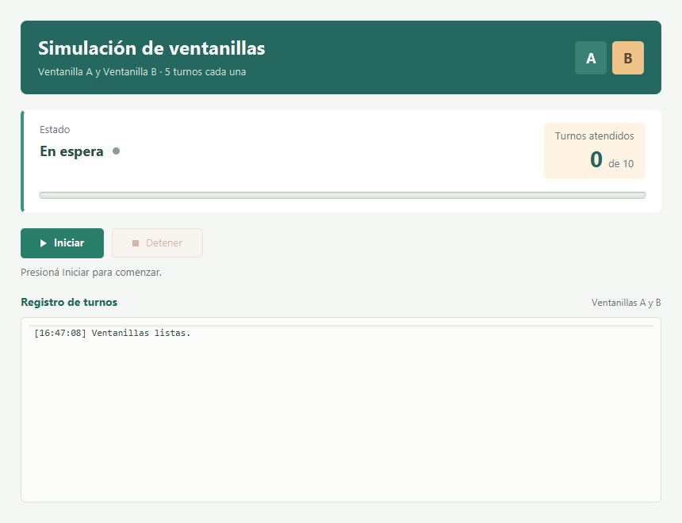

# Estación 5: integración JavaFX

Ejecutar la aplicación con `mvn clean javafx:run` o desde `app.MainApp` en IntelliJ.

En IntelliJ también se puede seleccionar **JavaFX - Interfaz** en las configuraciones de ejecución y presionar ▶. La configuración compartida está en `.run/JavaFX - Interfaz.run.xml`.

## Archivos

- `src/main/resources/vista/View.fxml`: botones Iniciar y Detener, estado, contador, progreso y logs; todos los estilos están en los atributos `style` del FXML.
- `controlador/VentanillasController.java`: inicio, cancelación, actualizaciones y coordinación de hilos.
- `app/MainApp.java`: carga `View.fxml` con `FXMLLoader` y obtiene su controlador.
- `tareas/ProcesoVentanilla.java`: trabajo simulado, bandera `volatile`, `detener()` y comprobaciones de interrupción.

## Comportamiento

1. **En espera**: Iniciar habilitado y Detener deshabilitado.
2. **Ejecutando**: se crean dos hilos nuevos, con cinco turnos por ventanilla; Iniciar permanece deshabilitado.
3. **Deteniendo**: se invoca `detener()` y se interrumpen las esperas de los trabajadores. Ambos botones quedan deshabilitados.
4. **Detenido**: todas las ventanillas terminaron después de una cancelación.
5. **Finalizado**: todas las ventanillas completaron su trabajo; el contador muestra diez turnos.

Desde Detenido o Finalizado, Iniciar comienza una ejecución nueva con contador cero y nuevos objetos Thread. El registro conserva el historial y numera las ejecuciones. Al cerrar la ventana también se solicita la detención.

Los trabajadores publican eventos con `Platform.runLater()`. Un hilo coordinador espera con `join()` la terminación real de ambas ventanillas y después publica el estado final. Ningún `join()` ni `sleep()` se ejecuta en el hilo de JavaFX. El contador usa el incremento sincronizado existente y se lee bajo el mismo monitor.

## Verificación

`src/test/java/app/PruebaIntegracionGui.java` es una prueba ejecutable con `main`, sin bibliotecas adicionales. No es una prueba JUnit ni se ejecuta automáticamente con `mvn test`.

Después de `mvn test-compile`, ejecutar su `main` desde IntelliJ con las dependencias JavaFX del proyecto. Comprueba estados, botones, doble inicio, contador, logs, cancelación, reinicio con hilos nuevos y cierre durante la ejecución. Crea una escena sin mostrar ventanas.

También comprueba tres ciclos de inicio y detención inmediata, y que los cambios de estado, contador y logs se hagan en el hilo de JavaFX. `src/test/java/tareas/PruebaCancelacion.java` verifica por separado la bandera y las interrupciones, antes de iniciar y durante la espera, incluyendo la conservación del estado de interrupción.

Para editar el diseño, abrir `src/main/resources/vista/View.fxml` en IntelliJ o Scene Builder. La presentación está definida dentro del propio FXML y no requiere un archivo CSS separado.
